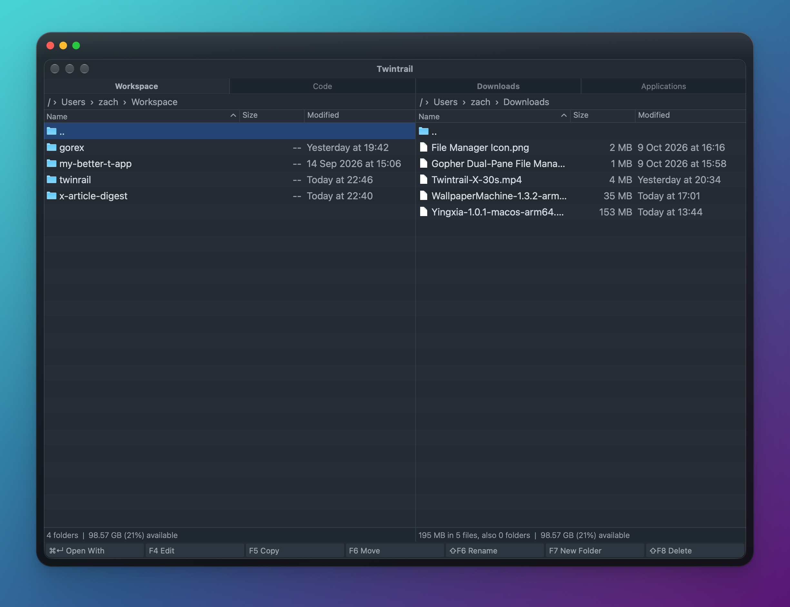

# Twintrail

<p align="center">
  
</p>



A macOS native dual-pane file manager built on Go and myGO v0.4.2. Fully native UI, no WebView. Follows Marta's dual-pane navigation and shortcut habits, and performs real file operations.

## Implemented

- Directories first, name ascending or descending, hidden-file toggle, name substring filter.
- Copy, move, rename, create nested directories, move to the macOS Trash, with confirmation dialogs and error display.
- File operations and directory reads run in the background; stale directory read results are discarded.
- Copy preserves symlinks, refuses to overwrite an existing target, and refuses to copy or move a directory into itself. Cross-volume moves currently show an error and do not fall back to copy and delete.
- Open with the system default application, Quick Look preview, reveal in Finder, external Terminal, native context menu. The search box is hidden by default, shown with ⌘F or /. Copy Path writes the absolute paths of the marked entries to the pasteboard, one per line, each quoted so pasting into a terminal is safe.

## Font preferences

The app menu **Preference…** (⌘,) offers nine separate font settings: `actionBar`, `breadcrumbs`, `virtualTabs`, `files`, `statusBar`, `tableHeader`, `tabs`, `preferences`, `terminal`. Font names can be typed in directly, size range 8-48 pt. `Default` uses the system font (the Terminal uses the system monospace font), `Default Bold` and `Default Light` use the system bold and light fonts.

The current tab title uses `virtualTabs`, the other tab titles use `tabs`. Changes take effect immediately and the related row heights follow the size; the preferences window's own font can be changed too. The user's given default font setup can be restored in one click. Settings save automatically to the `fonts` field of the window state file, with no restart and no "Apply" click.

## Open With

⌘Return opens the application chooser, which queries the available applications for the selected files through the native macOS NSWorkspace. It includes the default application and the "All Applications…" system picker. With multiple files selected, it shows the applications all of them support.

Application names appear first and are immediately selectable, icons render in the background as 64×64 bitmaps. The application list is cached per selected path for one minute, showing the cache first and refreshing in the background when it expires; icons are cached per application path, so reopening does not start a script or convert an icon again.

## Embedded terminal

**View → Toggle Terminal** (⌘`) shows or hides the terminal of the current tab. The panel sits at the bottom of the window and uses myGO's native Ghostty terminal plugin.

Each tab keeps its own zsh login shell and scrollback history; hiding it does not end the session, closing the tab or the window releases it. When switching tabs or the active pane, the bottom shows that tab's terminal state.

After navigation succeeds, that tab's terminal CWD is synced. The sync uses a separate notification channel and does not inject a `cd` command into the terminal input stream; while a command is running, the sync waits for it to finish and keeps any typed but uncommitted command. Supports directory names with spaces and quotes. The sync is one-way, from the file panel to the terminal.

Packaging automatically fetches and signs `libghostty-vt`; a development environment needs to download the library on first run, and `MYGO_GHOSTTY_VT` can point at an already downloaded copy.

## Development

```sh
go install github.com/egoist/mygo/cmd/mygo@latest
go tool mygo dev
go tool mygo vet
```

To build the macOS app:

```sh
go tool mygo build --skip-dmg
open build/darwin-arm64/Twintrail.app
```

Tests cover the native UI lifecycle, focus and shortcuts, marking, hidden files, directory creation, copy move rename, overwrite and recursive target validation, as well as terminal toggle, separate sessions, directory sync, and close cleanup.